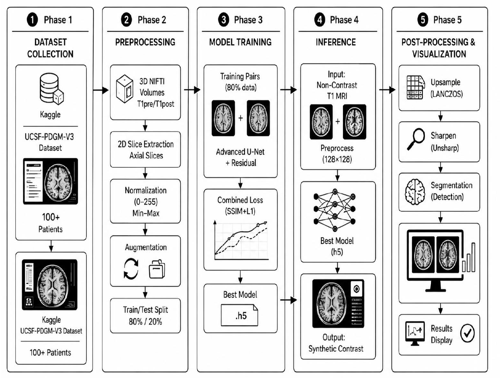
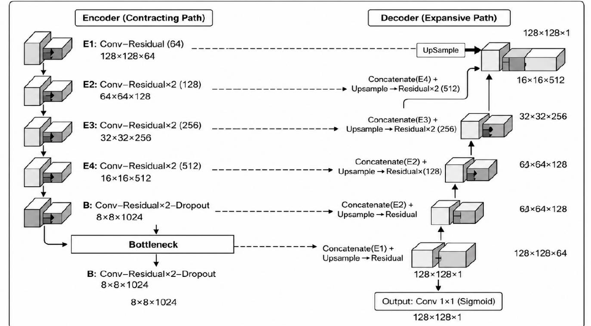

# Virtual Gadolinium: Deep Learning-Based Virtual Contrast MRI Synthesis and Brain Tumor Segmentation

Deep learning-based virtual contrast MRI synthesis (T1 pre → T1 post) using a residual U-Net, so no gadolinium contrast agent is needed.

> **Note:** This repository contains the published paper only. Source code and trained models are not included.

## Publication

- **Journal:** Spectrum of Engineering Sciences, Vol. 4, Issue 5, 2026, pp. 1831–1857
- **DOI:** https://doi.org/10.5281/zenodo.20321580
- **Paper (PDF):** [Download](https://github.com/laibaghalib/virtual-gadolinium-mri/raw/main/virtual-gadolinium.pdf)
- **Authors:** Samar Abbas, Muazzam Ali, Laiba Ghalib, Talha Aqeel, Reeba Waris Ali, Awais Ali, Zaeem Nazir (Department of Computer Science, University of Narowal)

## Summary

A residual U-Net that synthesizes gadolinium-enhanced T1-weighted MRI from unenhanced T1 images. It is trained on the UCSF-PDGM dataset (paired T1pre and T1post axial slices) with a combined SSIM + L1 loss, and the pipeline also includes post-processing and segmentation-guided visualization.

**Test set results:**

| Metric | Value |
|---|---|
| PSNR | 32.70 dB |
| SSIM | 0.9540 |

## Pipeline

Data preprocessing (3D NIfTI to 2D slices) → residual U-Net training → inference → post-processing (upsampling, sharpening) → segmentation-guided visualization.

## Architecture

## My contribution

- (Write here what you did, e.g. data preprocessing)
- (e.g. model training and evaluation)
- (e.g. paper writing)

## Cite

Abbas, S., Ali, M., Ghalib, L., Aqeel, T., Ali, R. W., Ali, A., & Nazir, Z. (2026). Virtual Gadolinium: Deep Learning-Based Virtual Contrast MRI Synthesis and Brain Tumor Segmentation. *Spectrum of Engineering Sciences*, 4(5), 1831–1857. https://doi.org/10.5281/zenodo.20321580
